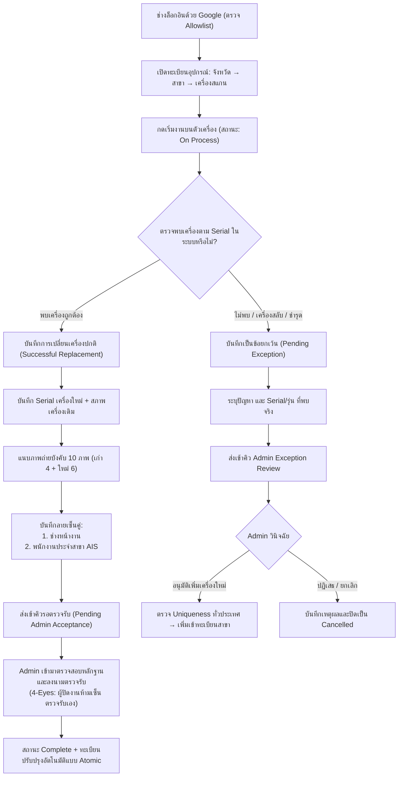

# AIS Scanner-First Operations Baseline (V1.2)

เอกสารข้อกำหนดกระบวนการทำงาน สถาปัตยกรรมระบบ และมาตรฐานความปลอดภัยสำหรับ **AIS Branch & Asset Operations (Scanner Replacement)**  
**สถานะ:** CURRENT PRODUCTION BASELINE (แทนที่กระบวนการ Work Order และ Campaign เดิมทั้งหมด)  
**อัปเดตล่าสุด:** 2026-11-12  

---

## 1. บทสรุปและวิสัยทัศน์โครงการ (Executive Summary & Vision)

ระบบเว็บแอปพลิเคชันสำหรับการบันทึก ตรวจสอบ และบริหารจัดการการเปลี่ยนเครื่องสแกนบาร์โค้ด (Scanner Replacement) ตามสาขาของ AIS ทั่วประเทศ (~1,992 เครื่อง ใน 580 สาขา) พัฒนาขึ้นเพื่อทดแทนการจัดการด้วยไฟล์ Excel ที่กระจัดกระจายและขาดการควบคุมความปลอดภัย

### วิวัฒนาการสู่ Scanner-First (Why Scanner-First?)
* **อดีต (Phase 1 & 2):** เคยออกแบบให้มีผู้วางแผน (Planner), จัดสรรทีม, นัดหมายวันลงพื้นที่ และเปิดใบงาน Work Order รวมรายสาขา
* **ความเป็นจริงหน้างาน (Root Reality):** ทีมช่างภาคสนามมีการประสานงานเส้นทางภายนอก (โทรศัพท์/LINE) อยู่แล้ว การบังคับนัดหมายหรือเปิดใบงานเยิ่นเย้อในระบบสร้าง Overhead โดยไม่จำเป็น
* **ปัจจุบัน (V1.2 Scanner-First):** ปรับเข้าสู่โมเดลที่ช่างเข้าถึงอุปกรณ์เป้าหมายได้โดยตรงตามลำดับ **จังหวัด → สาขา → เครื่องสแกน (Province → Branch → Scanner)** บันทึกผลได้ทันทีที่ตัวเครื่อง โดยยังคงระบบตรวจสอบ ประวัติ และหลักฐานอย่างครบถ้วน

---

## 2. บทบาทและการควบคุมการเข้าถึง (Roles & Authorization)

ระบบแบ่งบทบาทปฏิบัติงานเป็น 2 บทบาทหลักตามหลัก Least Privilege:

| บทบาท | หน้าที่และความรับผิดชอบในระบบ |
|---|---|
| **Admin (ผู้ดูแลระบบ)** | ดูแลทะเบียนอุปกรณ์, ตรวจสอบ/นำเข้า Excel, ติดตาม Dashboard ภาพรวม, วินิจฉัยรายการข้อยกเว้น (Exception Review), และลงนามตรวจรับส่งมอบงาน (Admin Acceptance) |
| **Onsite Technician (ช่างหน้างาน)** | เข้าถึงรายการเครื่องที่เปิดอยู่ทั้งหมด (Global Queue), เลือกเครื่องตามงานจริง, บันทึกเริ่มงาน (On Process), ถ่ายภาพหลักฐาน 10 ภาพ, เก็บลายเซ็นคู่ และส่งงานตรวจรับ |

> [!IMPORTANT]
> ระบบไม่มีบทบาท Planner หรือ Data Manager อีกต่อไป และช่างทุกคนสามารถมองเห็นเครื่องที่เปิดอยู่ได้ทั่วประเทศโดยไม่มี Team-gate บล็อกการทำงาน

### มาตรการยืนยันตัวตน (Authentication & Allowlist)
1. **Google OAuth 2.0:** เข้าสู่ระบบด้วยบัญชี Google ที่ผ่านการอนุมัติ (ไม่มีการตั้ง/จำรหัสผ่านในระบบ)
2. **Database Auth Hook (`before_user_created`):** สกัดกั้นอีเมลที่ไม่ได้อยู่ใน `app_private.google_signin_allowlist` ตั้งแต่ระดับ Database ก่อนที่ Supabase Auth จะสร้างบัญชี
3. **Database-Level Authorization:** สิทธิ์การอ่าน/เขียนถูกควบคุมด้วย **Row Level Security (RLS)** และ **RPC Functions ใน `app_private`** เท่านั้น การซ่อนปุ่มบน UI ไม่ถือเป็นด่านความปลอดภัย

---

## 3. วงจรการทำงานหน้างาน (End-to-End Workflow)



### สถานะของเครื่องและงาน (Asset & Task Lifecycle)
1. **Open:** เครื่องยังไม่มีงานเปลี่ยนที่กำลังดำเนินการ (พร้อมให้ช่างเริ่มงาน)
2. **On Process:**
   * *In Progress:* ช่างกดเริ่มงานและกำลังดำเนินการหน้างาน
   * *Pending (Paused):* พักงานชั่วคราวพร้อมระบุเหตุผล (เครื่องอื่นในสาขายังทำงานต่อได้)
   * *Pending (Exception):* พบปัญหาหน้างาน ส่งต่อให้ Admin วินิจฉัย
3. **Complete:** งานเปลี่ยนเสร็จสมบูรณ์ และผ่านการลงนามตรวจรับจาก Admin แล้ว
4. **Cancelled:** รายการถูกยกเลิกโดย Admin พร้อมบันทึกเหตุผลกำกับ

---

## 4. มาตรฐานหลักฐานหน้างานและลายเซ็น (Evidence & Signatures)

การปิดงานเปลี่ยนเครื่องปกติ (Successful Replacement) มีเกณฑ์บังคับหลักฐานอย่างเข้มงวด:

### 4.1 ภาพถ่ายบังคับ 10 ภาพ (Required Photos)
* **เครื่องเดิม (Old Scanner) 4 ภาพ:**
  1. ภาพ Serial Number เครื่องเดิม
  2. ภาพตัวเครื่องเดิมแบบเต็ม
  3. ภาพสภาพความเสียหาย หรือสภาพการใช้งานเดิม
  4. ภาพสติกเกอร์ทรัพย์สิน/ประจำสาขาเดิม
* **เครื่องใหม่ (New Scanner) 6 ภาพ:**
  1. ภาพ Serial Number เครื่องใหม่
  2. ภาพด้านหน้าตัวเครื่องใหม่
  3. ภาพด้านข้างตัวเครื่องใหม่
  4. ภาพ Serial บนกล่อง หรือ COM Serial
  5. ภาพตัวเครื่องใหม่ติดตั้งพร้อมใช้งาน
  6. ภาพการเชื่อมต่อสายสัญญาณและสายไฟ
* **ภาพสำรอง (Optional):** แนบเพิ่มได้สูงสุด 2 ภาพ สำหรับเก็บรายละเอียดสภาพแวดล้อมหน้างาน

### 4.2 ลายเซ็นคู่หน้างาน (Dual Signatures)
1. **ลายเซ็นช่างผู้ปฏิบัติงาน (Onsite Technician Signature):** ยืนยันการติดตั้งและทดสอบเรียบร้อย
2. **ลายเซ็นพนักงานประจำสาขา (Branch Scanner User Signature):** ยืนยันการรับมอบและทดสอบการใช้งานจริงที่เคาน์เตอร์

### 4.3 การควบคุมภายในและหลัก 4-Eyes (Admin Acceptance)
* งานที่ช่างส่งมาจะต้องรอให้ Admin ทำการตรวจสอบหลักฐานภาพถ่ายทั้ง 10 ภาพ และลายเซ็น ก่อนลงนามตรวจรับ (Inspector Signature)
* **กฎ Separation of Duties:** หากผู้ใช้งานบัญชี Admin เป็นผู้ลงไปปฏิบัติงานหรือกดบันทึกปิดงานหน้างานเอง บัญชีนั้นจะถูกบล็อกในระดับฐานข้อมูล ไม่สามารถเซ็นตรวจรับงานของตนเองได้ (ต้องให้อีกบัญชีหนึ่งเป็นผู้ตรวจรับ)

---

## 5. การจัดการข้อยกเว้นและคุ้มครองทะเบียน (Exception Governance)

* **ห้ามแก้ไขทะเบียนโดยพลการ (No Silent Mutations):** เมื่อช่างไม่พบเครื่อง หรือพบเครื่อง Serial ไม่ตรง ระบบจะไม่อนุญาตให้แก้ไข ย้าย หรือเพิ่มทรัพย์สินเข้าสาขาโดยอัตโนมัติ
* **Admin Review Queue:** รายการที่มีปัญหาจะถูกส่งเข้าคิว Pending เพื่อให้ Admin วินิจฉัย
* **Uniqueness Verification:** หาก Admin พิจารณาเพิ่ม Serial ใหม่เข้าระบบ ฐานข้อมูลจะตรวจสอบว่า Serial นั้นไม่เคยมีอยู่ในสาขาอื่นทั่วประเทศมาก่อน (ป้องกันการสลับเครื่องข้ามสาขาโดยไม่ได้รับอนุญาต)

---

## 6. สถาปัตยกรรมทางเทคนิคและความปลอดภัย (Architecture & Security)

### 6.1 Frontend Stack
* **React 19 + TypeScript + Vite:** Single Page Application (SPA) ประสิทธิภาพสูง
* **Mobile-First CSS:** ออกแบบรองรับหน้าจอสมาร์ทโฟนของช่างตั้งแต่ความกว้าง 320px ขึ้นไป พร้อมรองรับ Virtual Keyboard
* **AIS Green Design System:** ใช้ชุดสีองค์กร สะอาด ชัดเจน และสื่อสารสถานะอย่างแม่นยำ

### 6.2 Edge & Static Delivery
* **Cloudflare Static Assets / Workers:** เสิร์ฟไฟล์แบบ Static 100% ควบคุมต้นทุน 0 บาท
* **Content Security Policy (CSP):** กำหนด Policy ในไฟล์ `_headers` อนุญาตเฉพาะ Supabase HTTPS/WSS origin เท่านั้น ป้องกัน XSS และ Data Exfiltration

### 6.3 Database & Storage Layer
* **Supabase PostgreSQL 15+:**
  * แยก Schema ชัดเจน: `public` สำหรับ View ปลอดภัย และ Safe Public RPC Wrappers; `app_private` สำหรับ Core Tables, Auth Hook, ข้อมูลความลับ และ Security Functions
  * **Viewer Privacy:** กลไก Masking ปิดบังบางส่วนของ Serial Number สำหรับผู้มีสิทธิ์ระดับ Viewer
* **Evidence Storage:**
  * Supabase Private Bucket บังคับตรวจสอบ Content-Type, Content-Length และผูกสิทธิ์ตาม Task ID เพื่อป้องกันการอัปโหลดไฟล์แปลกปลอม

---

## 7. มาตรฐานการทดสอบและการกู้คืนระบบ (QA & Disaster Recovery)

### 7.1 การทดสอบอัตโนมัติ (Local Verification)
ก่อนส่งมอบงานทุกครั้ง ต้องรันคำสั่งตรวจสอบในโฟลเดอร์ `web/`:
```powershell
npm run typecheck    # ตรวจสอบ TypeScript ทั้งโปรเจกต์
npm run build        # ทดสอบการ Build Bundle และสร้าง CSP headers
npm run test:xlsx    # ทดสอบตัวประมวลผลไฟล์ Excel
npm run test:app     # ทดสอบ E2E Flow ของแอปพลิเคชัน
npm run test:db      # ทดสอบความปลอดภัยและสิทธิ์ฐานข้อมูลด้วย pgTAP (386+ assertions)
npm run test:all     # รันชุดทดสอบทั้งหมดรวมกัน
```

### 7.2 การสำรองและกู้คืนระบบ (Disaster Recovery)
* ดำเนินการตาม [recovery-runbook.md](recovery-runbook.md)
* สำรองข้อมูลด้วย Supabase CLI (`db dump` แยก Roles, Schema, Data)
* เข้ารหัสไฟล์สำรองด้วย **7-Zip AES-256** ก่อนซิงค์ไปเก็บใน OneDrive โดยไม่มีค่าใช้จ่ายเพิ่มเติม
* ทำการซ้อมกู้คืนข้อมูลบนฐานข้อมูลจำลอง (Isolated Restore Drill) เป็นระยะเพื่อยืนยันความพร้อม
